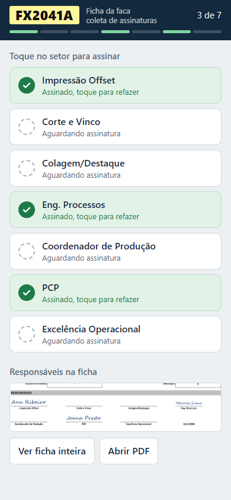
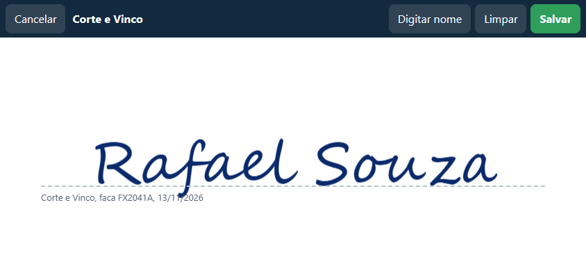
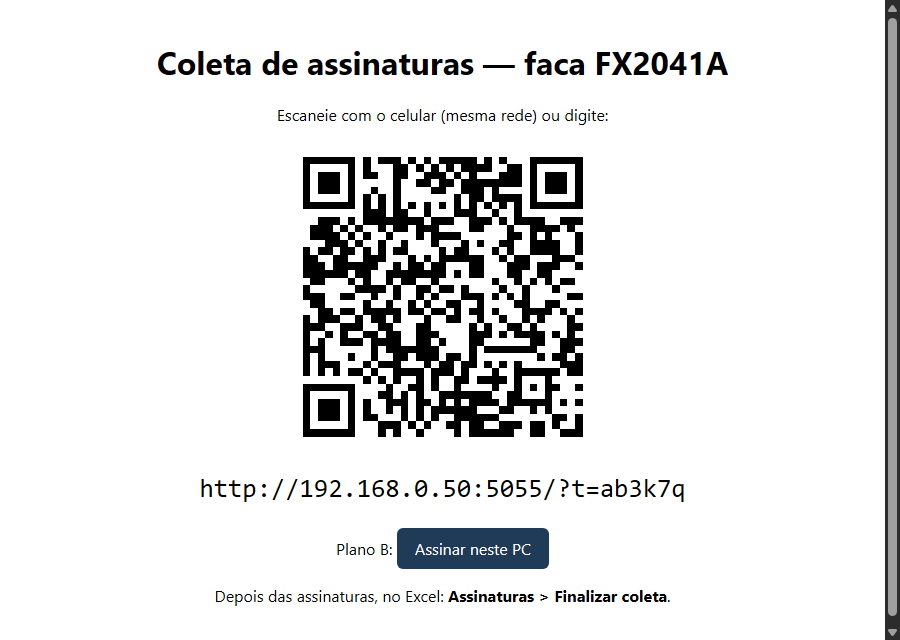
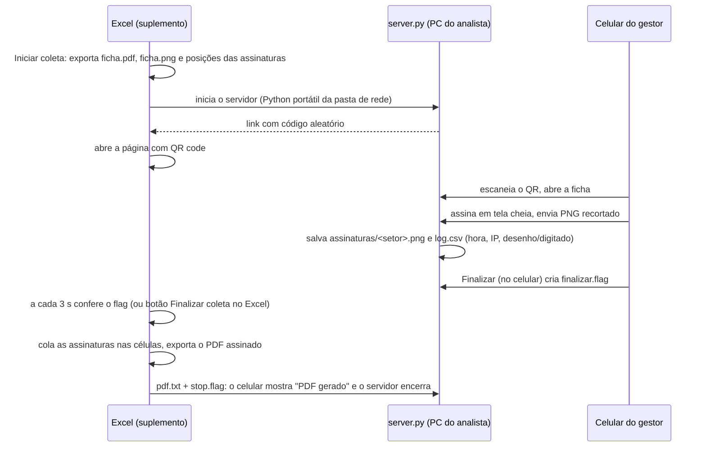

# Assinatura digital da ficha da faca

Coleta das assinaturas dos gestores de cada setor numa ficha técnica do Excel, pelo celular, sem imprimir.
Um botão no Excel sobe um mini servidor na rede local, mostra um QR code, os gestores assinam com o dedo e um
segundo botão gera o PDF final já assinado.

> **Contexto:** este projeto foi pensado, desenvolvido e aplicado **sob demanda, num ambiente corporativo real**
> (indústria de embalagens), para substituir um processo manual: imprimir a ficha da faca e levar o papel de
> setor em setor para coletar a assinatura de cada gestor. Neste repositório, a empresa, a ficha, os nomes e
> os códigos são **fictícios**; nenhum dado da empresa original foi incluído.

| Celular: setores | Celular: assinatura | PC: QR code e plano B |
|---|---|---|
|  |  |  |

Resultado: [`exemplo/FX2041A_assinada.pdf`](exemplo/FX2041A_assinada.pdf), a ficha fictícia com três assinaturas aplicadas.

## O problema

- A ficha técnica de cada faca (ferramenta de corte e vinco) precisa da assinatura de 7 gestores.
- O processo era imprimir, andar pela fábrica atrás de cada um e arquivar papel: lento e sem rastro de quem assinou quando.

## A solução



## Destaques

- **Zero dependências:** o servidor usa só a biblioteca padrão do Python. Roda com o Python *embeddable*
  oficial enxugado para 13 MB, numa pasta oculta da rede. Nenhum PC precisa instalar nada além do suplemento.
- **Layout vem do próprio Excel:** o macro mede as células de assinatura e grava as posições em `slots.json`;
  a página mostra cada assinatura salva no lugar exato da ficha.
- **Feito para o chão de fábrica:** botões grandes por setor, tela cheia com o celular deitado, traço suavizado,
  progresso de 7 segmentos, prévia só do bloco de responsáveis e visualizador com zoom.
- **Finalizar pelo celular:** depois da última assinatura, o próprio celular pede o PDF. O Excel, aberto no PC,
  gera o arquivo e o celular mostra o nome dele. Com setor faltando, o botão pede um segundo toque.
- **Retomar depois de um imprevisto:** as assinaturas ficam salvas na pasta da coleta e o código do link também.
  Clicar de novo em Iniciar coleta, horas depois, sobe o servidor com o mesmo link e o que já foi assinado; se o
  servidor ainda estiver no ar, só reabre o QR.
- **Plano B no PC:** a mesma página abre no navegador do PC; dá para desenhar com o mouse ou digitar o nome, que
  vira assinatura cursiva. O `log.csv` registra se foi desenhada ou digitada.
- **Seguro o bastante para a rede interna:** código de 6 caracteres por coleta (sem letras ambíguas), validação
  do PNG, limite de tamanho, setores permitidos por lista e porta exclusiva (no Windows, sem isso uma segunda
  coleta dividiria a porta com a primeira).
- **Leve:** página de ~15 KB sem frameworks; a imagem da ficha é exportada do Excel em 2x para ficar nítida.
- **Logo opcional:** um `logo.svg` ao lado do `server.py` aparece no cabeçalho (fica fora do repositório).

## Estrutura

```
Coleta.bas            macro VBA (Iniciar / Finalizar coleta + botões da guia "Assinaturas")
server.py             servidor da página de assinatura (biblioteca padrão)
test_server.py        auto-teste do servidor
instalar.cmd          instala o suplemento num PC (Excel fechado)
tools/baixar_python.ps1   baixa e enxuga o Python embeddable para python\
tools/build_xlam.ps1      gera Coleta.xlam a partir do Coleta.bas
tools/ribbon.py           injeta a guia "Assinaturas" (customUI) no .xlam
exemplo/              ficha fictícia (FICHA_EXEMPLO.xlsx), artefatos de uma coleta e o PDF assinado
```

## Testar a página em 1 minuto (sem Excel)

```
python server.py exemplo/FX2041A
```

Abra o link gravado em `exemplo/FX2041A/url.txt` (no PC ou num celular na mesma rede). Para encerrar, crie o
arquivo `exemplo/FX2041A/stop.flag` ou use Ctrl+C.

## Implantar

1. Copie o repositório para uma pasta de rede e ajuste `BASE` no `Coleta.bas` (caminho UNC, `\\servidor\...`).
2. `tools/baixar_python.ps1` coloca o Python portátil em `python\`.
3. `tools/build_xlam.ps1` gera o `Coleta.xlam`.
4. Em cada PC: feche o Excel e rode `instalar.cmd`. Aparece a guia **Assinaturas**.
5. A aba da ficha é encontrada pela constante `ABA` (padrão `FICHA*`); as células de assinatura ficam em `Slots()`.

Uso: código da faca na célula `D2` > **Iniciar coleta** > gestores assinam > **Finalizar** (no celular ou no Excel). O PDF vai para
`Assinadas\<faca>_assinada_<data>.pdf` e a coleta (com `log.csv`) é arquivada em `Coletas\`.

## Testes

```
python test_server.py
```

Cobre token, página do QR, setores fora da lista, PNG inválido, path traversal, log desenho/digitado, porta
exclusiva, retomada com o mesmo link e finalização pelo celular (incluindo erro e nova tentativa). O fluxo completo (macro + servidor + PDF) foi validado pelo Excel via automação COM.

## Limitações

- HTTP sem criptografia: pensado para a rede interna; o celular precisa estar na mesma rede do PC.
- Assinatura desenhada é um controle interno, não assinatura com validade jurídica.
- O QR code usa uma biblioteca do cdnjs; sem internet no PC, a página mostra só o link.
- Iniciar coleta usa a área de transferência para gerar a imagem da ficha.
- Finalizar pelo celular precisa do Excel aberto no PC com a planilha da ficha (o PDF é gerado por ele).

## Licença

[MIT](LICENSE)
